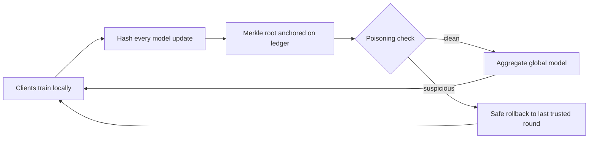

<h1 align="center">Hi, I'm Tawfek 👋</h1>

<h3 align="center">Blockchain Lead · Web3 Security Architect</h3>

  <i>I build blockchain systems you can audit, and I test them the way an attacker would.</i>

  
  
  

---

## 👨‍💻 About me

- 🎓 CSE graduate from **Daffodil International University**, Dhaka, Bangladesh 🇧🇩
- 🔐 My work is around **blockchain security, federated learning, and AI**
- 🛰️ My long-term interest is **aerospace cybersecurity** (and yes, I love astrophysics too)
- 🎯 My goal: work remotely as a **blockchain lead / security architect**
- 📝 I am writing research papers for **Q1 / SCIE-indexed** journals and good conferences
- 🧰 I work on **Kali Linux** and **Parrot OS**

---

## 🧭 What I focus on

| Area | What it means in my work |
|---|---|
| ⛓️ **Blockchain auditability** | Tamper-evident logs, Merkle provenance, on-chain audit trails |
| 🛡️ **Secure federated learning** | Poisoning detection, safe rollback, differential privacy |
| 🏥 **Medical AI** | Clinical decision support, multimodal VQA, privacy-first training |
| 🕵️ **Security hands-on** | Kali / Parrot, network labs, access control (ACLs) |

---

## 🚀 Featured work

| Project | What it does | Tech |
|---|---|---|
| **AFCDL** – Auditable Federated Clinical Decision Ledger | My Final Year Design Project (**result: 4.00**). Federated learning for clinical decisions with an audit ledger. Includes a Flask dashboard, a full `.py` pipeline, and fixes for 4 real bugs (one was a differential privacy correctness issue). 43-entry bibliography. | Python, Flask, Federated Learning, Differential Privacy, Blockchain |
| [**Federated-IDS-Blockchain-Rollback**](https://github.com/AstroTawfek/Federated-IDS-Blockchain-Rollback) | Blockchain-audited federated intrusion detection. Model updates are anchored with **Merkle provenance**, poisoned updates are detected, and the system can **roll back safely**. | Python, NSL-KDD, CICIDS2017, Merkle trees |
| **Federated Medical VQA** | Multimodal visual question answering on **VQA-RAD**, extended to a **FedAvg** setup with simulated clients. | Python, Multimodal ML, FedAvg |
| **SafeID** | Blockchain-based identity white paper, made for a Blockchain Olympiad. | Blockchain, Identity, White paper |
| [**Banglish Chatbot**](https://github.com/AstroTawfek/banglish-chatbot) | Banglish → Bangla transliteration chatbot, deployed on Hugging Face Spaces. | Seq2Seq LSTM + Attention |

<!-- ✏️ EDIT: add direct links for AFCDL, Medical VQA and SafeID once those repos / PDFs are public -->

### 🔄 How my federated IDS thinks (simplified)

---

## 📚 Research (in progress)

| Paper | Topic | Status |
|---|---|---|
| **BFIPPDSR** | IEEE journal paper | ✍️ Writing / Overleaf stage |
| **Bangla NLP** | Sentiment analysis + Sadhu–Cholito style transfer (TF-IDF, Logistic Regression, mT5) | 🔬 In progress |
| **Blockchain-Audited Federated IDS** | Refining for a high-quality journal / conference | 🔬 In progress |

---

## 🛠️ Tools I use

**Also:** XGBoost · Seq2Seq / LSTM · Cisco Packet Tracer · MariaDB / XAMPP · Tailwind / DaisyUI · Arduino

---

## 🤝 Open to

- ✅ Blockchain Lead / Web3 Security Architect roles (remote)
- ✅ Smart contract security and blockchain security engineering
- ✅ Research work in **federated learning, medical AI, and blockchain security**
- ✅ Collaboration on papers and open-source security tools

**Ask me about:** federated learning security, Merkle-based audit trails, medical AI, and how to break (and then fix) things.

---

## 📫 Connect

- 💼 [LinkedIn – Mohammad Ullah Tawfek](https://www.linkedin.com/in/mohammad-ullah-tawfek/)
- 📧 tawfek.contact@gmail.com
- 🐙 [github.com/AstroTawfek](https://github.com/AstroTawfek)

---

  
  

<i>Looking at the stars, thinking about systems that stay secure. 🌌</i>

